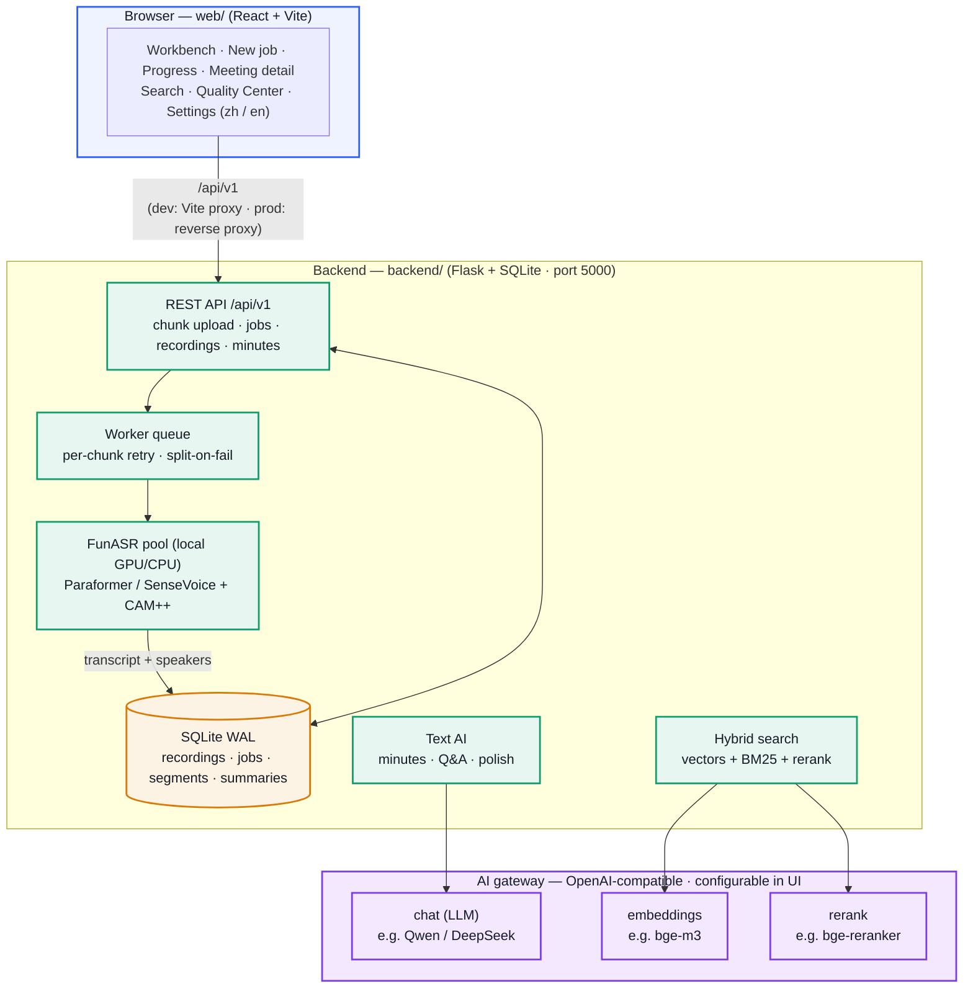

# MeetScribe

**Self-hosted meeting intelligence:** speech-to-text, speaker diarization, AI minutes, and cross-meeting semantic search.

Upload long recordings (up to 4 GB, auto-chunked) and get timestamped, speaker-labeled transcripts. Generate structured meeting minutes (key points / action items / risks, each traceable to the source line). Search across past meetings with natural language. The UI supports **Chinese and English**.

> **Speech recognition runs fully on-device** (FunASR Paraformer / SenseVoice + CAM++ diarization). Audio never leaves the host.
> Summaries, Q&A, and search use a configurable **OpenAI-compatible gateway** (local open models or cloud APIs).

中文文档：[README.zh-CN.md](README.zh-CN.md)

---

## Features

- **Long-form transcription** — Chunked upload, job queue, per-chunk retry and split-on-failure fallback; resume after interruption. Summary/polish job state is persisted (`ai_jobs`); progress survives process restart.
- **Speaker diarization** — CAM++ embeddings with cross-chunk centroid clustering; optional preset speaker count.
- **Readable speaker names** — Rename speakers in the transcript view (propagates to full text, search index, and exports). Optional on-device voiceprint library to recognize the same person across meetings (features stored locally; can be deleted).
- **Line-level review** — Low-confidence segments are flagged. Quality Center supports filter by recording / reason / confidence and bulk confirm. Edits sync the search index.
- **AI minutes** — Built-in *Meeting* and *Personal memo* templates, plus custom templates. Long meetings use *global outline → chunk summaries → merge*. Each bullet carries speaker and `[mm:ss]` for jump-to-audio. No content is invented beyond the transcript.
- **AI Q&A** — Ask over the current meeting (or selected transcript); answers cite original lines with timestamps.
- **Semantic search** — Hybrid retrieval: embedding recall + BM25 (Chinese bigrams) + rerank. Async background indexing with one-click rebuild. Filters: date, speaker, folder. Results grouped by meeting.
- **Export** — SRT / VTT subtitles, timestamped plain-text transcript, Markdown minutes, Word (.docx) minutes + full transcript (falls back to transcript if no summary yet).
- **Ops metrics** — Job/chunk timing, queue depth, recent failures via `GET /api/v1/system/metrics` (admin); Prometheus exposition at `GET /api/v1/system/metrics.txt`.
- **Library management** — Folders, batch move/delete, 7-day trash with restore.
- **Bilingual UI** — zh / en with browser language detection and persisted preference.
- **Optional auth** — Bearer API keys with multi-tenant data isolation (`tenant:secret`, `*:admin`). Unconfigured = anonymous mode (default; trusted networks only).

---

## Architecture

Speech runs **entirely locally**. Text AI (minutes / Q&A / search) goes through a configurable OpenAI-compatible gateway.



---

## Repository layout

```
meetscribe/
├── backend/                 # Flask API (/api/v1)
│   ├── app.py               # Routes
│   ├── config.py            # Config (env overrides)
│   ├── engine.py            # FunASR pipeline
│   ├── worker.py            # Job queue worker (+ webhook SSRF checks)
│   ├── store.py             # SQLite layer
│   ├── summary.py / ask.py / rewrite.py / polish.py
│   ├── search.py / gateway_client.py
│   ├── runtime_settings.py  # Hot-reload gateway settings from UI
│   ├── run.sh               # Bootstrap venv + start
│   ├── Dockerfile
│   ├── tests/               # Smoke / unit tests (no GPU required)
│   └── tools/               # Offline eval & dataset helpers
├── web/                     # React + Vite frontend
│   ├── Dockerfile / nginx.conf
│   └── src/                 # pages · components · i18n · api
├── docker-compose.yml       # CPU / GPU / web profiles
├── .env.example             # Production env template
├── LICENSE                  # Apache-2.0
├── README.md                # English (this file)
└── README.zh-CN.md          # 中文文档
```

---

## Quick start

### Requirements

- Python 3.10+, Node.js 18+
- **ffmpeg** (required): `apt install ffmpeg` / `brew install ffmpeg`
- GPU optional: CUDA speeds ASR roughly 5–10×; CPU works for shorter files
- First run downloads model weights from ModelScope (~1–2 GB+, cached under `./models` in Docker)

### Option A — Docker (recommended)

```bash
# Backend only (API on http://localhost:5000)
docker compose up -d

# GPU backend (CUDA 12.8; needs nvidia-container-toolkit)
docker compose --profile gpu up -d

# Backend + web UI (UI on http://localhost:8080, /api reverse-proxied)
docker compose --profile web --profile gpu up -d
```

Notes:

- Data (uploads, audio, results, SQLite) lives in `./data`; models in `./models`.
- Copy `.env.example` → `.env` and set gateway + security vars before public exposure.
- Dependency ranges are pinned to tested major versions in `backend/requirements.txt`.

### Option B — Local backend + frontend

**Backend**

```bash
cd backend
bash run.sh          # creates venv, installs deps, starts on http://127.0.0.1:5000
```

For GPU PyTorch (example CUDA 12.1), install torch first, then `run.sh`:

```bash
pip install torch --index-url https://download.pytorch.org/whl/cu121
```

**Frontend**

```bash
cd web
npm install
npm run dev          # http://localhost:5173 — /api proxied to :5000
# production build → web/dist/ (serve with nginx and reverse-proxy /api)
npm run build
```

**Tests** (no GPU / models required):

```bash
cd backend && pip install -r requirements-dev.txt && python -m pytest tests/ -q
```

### AI gateway (minutes / Q&A / search)

Open **Settings → AI service** in the UI:

| Field | Purpose | Local example |
|---|---|---|
| Gateway URL | OpenAI-compatible base URL | `http://127.0.0.1:9997/v1` (Xinference) |
| API key | Bearer token | optional for local stacks |
| LLM model | Minutes / Q&A | `qwen2.5-7b-instruct` |
| Embedding model | Vector recall | `bge-m3` |
| Rerank model | Reranking | `bge-reranker-v2-m3` |

Use **Test connection**, then **Apply**. Settings hot-reload without restart.

Env equivalents: `ASR_GATEWAY_URL`, `ASR_GATEWAY_TOKEN`, `ASR_LLM_MODEL`, `ASR_EMBED_MODEL`, `ASR_RERANK_MODEL`.

> Transcription alone does **not** need a gateway — ASR is fully local.

---

## Environment variables

Full list lives in `backend/config.py`. Common ones:

| Variable | Default | Description |
|---|---|---|
| `ASR_GATEWAY_URL` / `ASR_GATEWAY_TOKEN` | empty | AI gateway |
| `ASR_DATA_DIR` | `backend/data` | Data root |
| `ASR_DB_PATH` | `<data>/asr.db` | SQLite path |
| `ASR_CHUNK_SECONDS` | `300` | Chunk length (seconds) |
| `ASR_BACKEND` | `paraformer` | `paraformer` \| `sensevoice` |
| `ASR_WORKERS` | `1` | Worker threads |
| `ASR_API_KEYS` | empty | Auth, e.g. `tenant1:secret1,*:adminsecret` |
| `ASR_MEDIA_SIGN_SECRET` | empty | Signed media URLs when set |
| `ASR_MAX_UPLOAD_MB` | `4096` | Max upload size |
| `ASR_WEBHOOK_ALLOWED_HOSTS` | empty | Comma-separated exact host allowlist for callbacks |
| `ASR_WEBHOOK_ALLOW_PRIVATE` | `0` | Set `1` to disable SSRF checks (trusted LAN only) |

---

## Security (read before deploying)

- **Anonymous mode is for trusted networks only** (localhost / home LAN). Without `ASR_API_KEYS`, anyone on the network can read transcripts, submit jobs, and change the AI gateway.
- **Before office LAN or public internet:**
  - Set `ASR_API_KEYS` (e.g. `me:secret1,*:adminsecret`). All `/api` calls need `Authorization: Bearer <secret>`.
  - Set `ASR_MEDIA_SIGN_SECRET` so media downloads require a signed token.
  - Terminate TLS with nginx/Caddy (or equivalent).
- **Webhook SSRF protection:** Outbound `callback_url` requests are validated. Loopback, RFC1918 private, link-local, and cloud metadata addresses are blocked by default. Allow specific hosts with `ASR_WEBHOOK_ALLOWED_HOSTS`, or set `ASR_WEBHOOK_ALLOW_PRIVATE=1` only on fully trusted networks.
- **Secrets:** Gateway tokens are stored server-side in `backend/data/runtime_settings.json` (gitignored); the UI shows a masked value only.

---

## Tools & evaluation

`backend/tools/` includes CLI transcription, diarization dumps, CER evaluation, and helpers for public datasets (AMI / AISHELL-4). See `backend/tools/README.md`.

---

## Known limitations

- ~~Summary/polish progress lived only in memory and was lost on restart~~ — **fixed**: state is stored in `ai_jobs` and restored after restart.
- Tenant daily quotas are soft limits; extreme concurrency can race (irrelevant for single-user use).
- Full account login/sessions are not built yet; multi-tenant isolation is via API keys (recordings, search, minutes, templates).
- ASR models are primarily tuned for Chinese; English / mixed speech may need extra validation.
- After changing search tokenization (Chinese bigrams), run a full reindex from the Search page so BM25 matches the new token style.

---

## License

[Apache-2.0](LICENSE)
