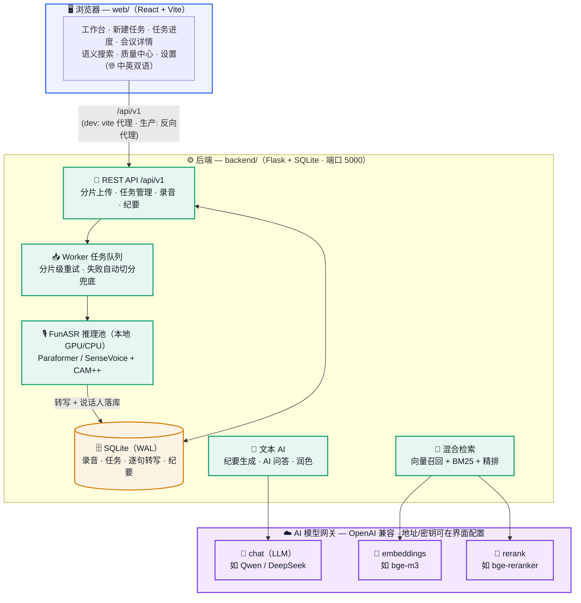

# MeetScribe · 聆语会议

**语音转写 + 说话人分离 + AI 纪要 + 跨会议语义检索** 的自托管系统。

上传长录音（最长 4GB，自动分片），得到逐句带时间戳、带说话人标签的转写；一键生成结构化会议纪要（要点 / 行动项 / 风险，逐条可溯源到原句）；用自然语言在历史会议中语义检索。界面支持中英双语。

> 转写引擎 FunASR（Paraformer / SenseVoice）与声纹聚类（CAM++）**完全本地运行**，音频不出本机；
> 纪要 / 问答 / 检索等文本 AI 走可配置的 OpenAI 兼容网关，可指向本地部署的开源模型或云 API。

## 功能特性

- **长音频转写**：分片上传 + 任务队列 + 分片级失败重试/自动切分兜底，断点可续
- **说话人分离**：CAM++ 声纹 + 跨分片质心聚类，支持预设说话人数
- **逐句校对**：低置信度句子自动标记，人工修正后同步检索索引与字幕导出（SRT/VTT）
- **AI 纪要**：内置会议纪要 / 单人备忘模板，可自定义模板（章节、指导语、生成选项）；要点逐条附说话人与 `[mm:ss]` 时间戳，未在转写中出现的内容不输出
- **AI 问答**：基于当前会议或多段转写内容问答，回答引用原话并标注时间戳
- **语义检索**：Embedding 向量召回 + BM25 + Rerank 精排的混合检索，跨会议定位到原句
- **质量中心**：复核队列、置信度报表、批量确认
- **回收站**：删除 7 天内可恢复；文件夹归类与批量管理
- **双语界面**：中文 / English，浏览器语言自动检测，选择持久化
- **可选鉴权**：程序化调用支持 Bearer API Key（多租户），未配置则保持匿名（默认）

## 系统架构

> 🎙️ 语音转写**完全本地运行**，音频不出本机；纪要 / 问答 / 检索等文本 AI 走可配置的 OpenAI 兼容网关。



## 目录结构

```
meetscribe/
├── backend/                 # Flask 后端（API 前缀 /api/v1）
│   ├── app.py               # 路由与接口
│   ├── config.py            # 全部配置（环境变量可覆盖）
│   ├── engine.py            # FunASR 推理流水线
│   ├── worker.py            # 任务队列 worker
│   ├── store.py             # SQLite 数据层
│   ├── summary.py / ask.py / rewrite.py / polish.py   # 文本 AI
│   ├── search.py / gateway_client.py                  # 检索与网关客户端
│   ├── runtime_settings.py  # 网关配置热更新（界面可改）
│   ├── run.sh               # 启动脚本（自动建 venv）
│   └── tools/               # 离线评测与数据集工具（见 tools/README.md）
├── web/                     # React + Vite 前端
│   └── src/                 # pages / components / i18n / api
├── LICENSE                  # Apache-2.0
└── README.md
```

## 快速开始

### 0. 系统要求

- Python 3.10+；Node.js 18+
- **ffmpeg**（音频解码/归一化，必装）：`apt install ffmpeg` / `brew install ffmpeg`
- GPU 可选：有 CUDA 显卡时转写快 5~10 倍；纯 CPU 也能跑（长录音耗时较长）
- 首次启动会从 ModelScope 自动下载模型权重（约 1~2 GB）

### 1. 启动后端

```bash
cd backend
bash run.sh          # 首次运行自动创建 venv 并安装依赖，然后前台启动
# 服务地址：http://127.0.0.1:5000
```

GPU 版 torch 请按你的 CUDA 版本先手动安装（覆盖 CPU 版）：

```bash
pip install torch --index-url https://download.pytorch.org/whl/cu121
```

生产环境建议用 systemd / supervisor 托管，示例见 `backend` 目录注释。

### 1b. 一键 Docker 启动（推荐，P0-4）

```bash
# CPU 版（后端 API，http://localhost:5000）
docker compose up -d

# GPU 版（CUDA 12.8，需 nvidia-container-toolkit）
docker compose --profile gpu up -d

# 连同前端一起启动（前端 http://localhost:8080，已反代 /api）
docker compose --profile web --profile gpu up -d
```

说明：
- 数据（上传/音频/结果/SQLite）持久化在 `./data`，模型缓存在 `./models`——首次启动会自动从
  modelscope 下载模型（数 GB），之后重启不再重复下载。
- AI 网关与安全配置通过 `.env` 或环境变量注入：`ASR_GATEWAY_URL` / `ASR_GATEWAY_TOKEN` /
  `ASR_API_KEYS` / `ASR_MEDIA_SIGN_SECRET`（公网部署务必配置后两项，见「安全须知」）。
- 依赖版本已按实测组合锁定（见 `backend/requirements.txt`），升级请整组回归验证。

### 2. 启动前端

```bash
cd web
npm install
npm run dev          # 开发模式 http://localhost:5173（/api 已代理到 5000）
# 或生产构建：
npm run build        # 产物在 web/dist/，用 nginx 等静态托管并反代 /api
```

### 3. 配置 AI 网关（纪要 / 问答 / 检索需要）

打开界面右上角 **设置 → AI 服务（模型网关）**，填写：

| 字段 | 说明 | 本地自部署示例 |
|---|---|---|
| 网关地址 | OpenAI 兼容 base URL | `http://127.0.0.1:9997/v1`（Xinference） |
| API 密钥 | Bearer Token | 本地服务可留空占位 |
| LLM 模型 | 纪要 / 问答 | `qwen2.5-7b-instruct` |
| Embedding 模型 | 语义检索向量召回 | `bge-m3` |
| Rerank 模型 | 检索精排 | `bge-reranker-v2-m3` |

点「测试连接」验证后「应用并保存」——配置热生效，无需重启。
也可以用环境变量预置：`ASR_GATEWAY_URL` / `ASR_GATEWAY_TOKEN` / `ASR_LLM_MODEL` / `ASR_EMBED_MODEL` / `ASR_RERANK_MODEL`。

> 只用转写功能可以不配置网关——语音识别全程本地运行。

## 常用环境变量（均可在 `config.py` 查看完整列表）

| 变量 | 默认 | 说明 |
|---|---|---|
| `ASR_GATEWAY_URL` / `ASR_GATEWAY_TOKEN` | 空 | AI 网关地址与密钥 |
| `ASR_DATA_DIR` | `backend/data` | 录音/结果/数据库存储目录 |
| `ASR_DB_PATH` | `<data>/asr.db` | 数据库路径（Windows 挂载盘建议指到本地盘） |
| `ASR_CHUNK_SECONDS` | 300 | 转写分片时长 |
| `ASR_BACKEND` | paraformer | 默认 ASR 后端（paraformer / sensevoice） |
| `ASR_WORKERS` | 1 | 后台任务线程数 |
| `ASR_API_KEYS` | 空 | 程序化调用鉴权，如 `tenant1:secret1,*:adminsecret` |
| `ASR_MAX_UPLOAD_MB` | 4096 | 单文件上限（MB） |

## 安全须知（部署前必读）

- **默认匿名模式仅适合可信网络**（本机 / 家庭局域网）。未配置 `ASR_API_KEYS` 时，同一网络内的任何人都可以：读取全部录音与转写、提交任务、修改 AI 网关配置。
- **暴露到办公室/公网前必须**：
  - 设置 `ASR_API_KEYS`（如 `me:secret1,*:adminsecret`），此后所有 `/api` 请求需带 `Authorization: Bearer <secret>`；
  - 建议同时设置 `ASR_MEDIA_SIGN_SECRET` 启用音频下载签名，防止音频直链被转发滥用；
  - 用 HTTPS 反向代理（nginx/caddy）承载。
- **回调地址（callback_url）由任务提交方提供**，服务端会在任务完成后向其 POST 结果——未做内网地址过滤（SSRF）。单机自用无碍；多租户开放时应在反代/防火墙层限制。
- 密钥存储：AI 网关密钥仅保存在服务端 `backend/data/runtime_settings.json`（已列入 .gitignore），界面只显示掩码。

## 工具与评测

`backend/tools/` 提供 CLI 转写、说话人日志导出、CER 评测与公开数据集（AMI / AISHELL-4）抓取脚本，
用于离线评测与回归测试，使用方法见 `backend/tools/README.md`。

## Known Issues

- 纪要/润色任务的进度表驻留内存，服务重启后丢失（任务本身落库，不影响结果，仅前端进度展示会回到轮询状态）
- 租户日配额为软限制，极端并发下存在检查竞态（单机自用无影响）
- 多用户体系（账户登录、数据隔离）在路线图中，当前为单用户匿名模式

## 许可证

[Apache-2.0](LICENSE)
