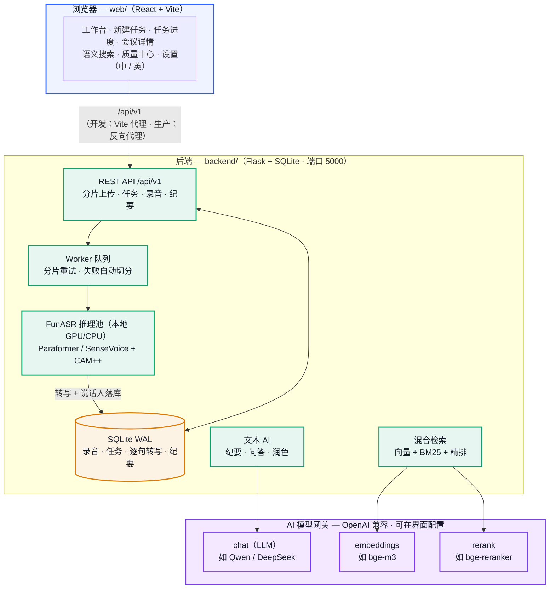

# MeetScribe · 聆语会议

**自托管会议智能系统：** 语音转写、说话人分离、AI 纪要、跨会议语义检索。

上传长录音（最长 4GB，自动分片），得到带时间戳、带说话人标签的逐句转写；一键生成结构化会议纪要（要点 / 行动项 / 风险，逐条可溯源到原句）；用自然语言在历史会议中语义检索。界面支持 **中文 / English**。

> **语音识别完全本地运行**（FunASR Paraformer / SenseVoice + CAM++ 说话人分离），音频不出本机。
> 纪要、问答、检索等文本 AI 走可配置的 **OpenAI 兼容网关**（可指向本地开源模型或云 API）。

English version: [README.md](README.md)

---

## 功能特性

- **长音频转写** — 分片上传、任务队列、分片级失败重试与自动切分兜底，支持断点续跑。纪要/润色任务状态落库（`ai_jobs`），服务重启不丢进度。
- **说话人分离** — CAM++ 声纹 + 跨分片质心聚类，可预设说话人数。
- **说话人可读名** — 转写页一键重命名（同步全文、检索索引与导出）。可选本机声纹库，跨会议自动认出同一人（特征仅存本机，可删除）。
- **逐句校对** — 低置信度句子自动标记。质量中心支持按录音 / 原因 / 置信度筛选与批量确认；人工修正后同步检索索引。
- **AI 纪要** — 内置「会议纪要」「单人备忘」模板，支持自定义。长会议采用「全局粗摘要 → 分块摘要 → 归并」。要点附说话人与 `[mm:ss]` 时间戳，可跳转原音频；不编造转写中未出现的内容。
- **AI 问答** — 基于当前会议（或选定转写）提问，回答引用原话并标注时间戳。
- **语义检索** — Embedding 向量召回 + BM25（中文 bigram）+ Rerank 精排。索引后台异步建立，可一键全量重建。支持日期 / 说话人 / 文件夹过滤；结果按会议分组展示。
- **导出** — SRT / VTT 字幕、带时间戳纯文本转写、Markdown 纪要（无纪要时回退为转写全文）。
- **运维指标** — 任务/分片耗时、队列深度、最近失败等：`GET /api/v1/system/metrics`（管理员）。
- **资料库管理** — 文件夹、批量移动/删除、7 天回收站可恢复。
- **双语界面** — 中文 / 英文，跟随浏览器语言并持久化选择。
- **可选鉴权** — Bearer API Key，多租户数据隔离（`租户:密钥`，`*:管理员`）。未配置时为匿名模式（默认，仅适合可信网络）。

---

## 系统架构

语音转写 **完全本地**；纪要 / 问答 / 检索走可配置的 OpenAI 兼容网关。



---

## 目录结构

```
meetscribe/
├── backend/                 # Flask API（前缀 /api/v1）
│   ├── app.py               # 路由
│   ├── config.py            # 配置（可用环境变量覆盖）
│   ├── engine.py            # FunASR 流水线
│   ├── worker.py            # 任务队列（含 webhook SSRF 校验）
│   ├── store.py             # SQLite 数据层
│   ├── summary.py / ask.py / rewrite.py / polish.py
│   ├── search.py / gateway_client.py
│   ├── runtime_settings.py  # 网关配置热更新
│   ├── run.sh               # 创建 venv 并启动
│   ├── Dockerfile
│   ├── tests/               # 冒烟 / 单元测试（无需 GPU）
│   └── tools/               # 离线评测与数据集工具
├── web/                     # React + Vite 前端
│   ├── Dockerfile / nginx.conf
│   └── src/                 # pages · components · i18n · api
├── docker-compose.yml       # CPU / GPU / web 配置
├── .env.example             # 生产环境变量模板
├── LICENSE                  # Apache-2.0
├── README.md                # English
└── README.zh-CN.md          # 本文档
```

---

## 快速开始

### 系统要求

- Python 3.10+，Node.js 18+
- **ffmpeg**（必装）：`apt install ffmpeg` / `brew install ffmpeg`
- GPU 可选：有 CUDA 时转写约快 5～10 倍；纯 CPU 也可跑（长录音更耗时）
- 首次启动会从 ModelScope 下载模型权重（约 1～2 GB+，Docker 下缓存在 `./models`）

### 方式 A — Docker（推荐）

```bash
# 仅后端（API：http://localhost:5000）
docker compose up -d

# GPU 后端（CUDA 12.8，需 nvidia-container-toolkit）
docker compose --profile gpu up -d

# 后端 + 前端（前端 http://localhost:8080，已反代 /api）
docker compose --profile web --profile gpu up -d
```

说明：

- 数据（上传 / 音频 / 结果 / SQLite）在 `./data`，模型在 `./models`。
- 公网暴露前请将 `.env.example` 复制为 `.env`，配置网关与安全相关变量。
- 依赖主版本区间见 `backend/requirements.txt`（按实测组合锁定）。

### 方式 B — 本地后端 + 前端

**后端**

```bash
cd backend
bash run.sh          # 自动创建 venv、安装依赖，监听 http://127.0.0.1:5000
```

GPU 版 PyTorch 示例（CUDA 12.1，先装 torch 再跑 `run.sh`）：

```bash
pip install torch --index-url https://download.pytorch.org/whl/cu121
```

**前端**

```bash
cd web
npm install
npm run dev          # http://localhost:5173，/api 代理到 5000
# 生产构建 → web/dist/（用 nginx 托管并反代 /api）
npm run build
```

**测试**（无需 GPU / 模型）：

```bash
cd backend && pip install -r requirements-dev.txt && python -m pytest tests/ -q
```

### 配置 AI 网关（纪要 / 问答 / 检索需要）

打开界面 **设置 → AI 服务**：

| 字段 | 用途 | 本地示例 |
|---|---|---|
| 网关地址 | OpenAI 兼容 base URL | `http://127.0.0.1:9997/v1`（Xinference） |
| API 密钥 | Bearer Token | 本地服务可留空 |
| LLM 模型 | 纪要 / 问答 | `qwen2.5-7b-instruct` |
| Embedding 模型 | 向量召回 | `bge-m3` |
| Rerank 模型 | 精排 | `bge-reranker-v2-m3` |

点「测试连接」后「应用并保存」，配置热生效，无需重启。

对应环境变量：`ASR_GATEWAY_URL`、`ASR_GATEWAY_TOKEN`、`ASR_LLM_MODEL`、`ASR_EMBED_MODEL`、`ASR_RERANK_MODEL`。

> 仅做转写时 **不必** 配置网关——语音识别全程本地完成。

---

## 常用环境变量

完整列表见 `backend/config.py`。常用项：

| 变量 | 默认 | 说明 |
|---|---|---|
| `ASR_GATEWAY_URL` / `ASR_GATEWAY_TOKEN` | 空 | AI 网关 |
| `ASR_DATA_DIR` | `backend/data` | 数据根目录 |
| `ASR_DB_PATH` | `<data>/asr.db` | SQLite 路径 |
| `ASR_CHUNK_SECONDS` | `300` | 分片时长（秒） |
| `ASR_BACKEND` | `paraformer` | `paraformer` \| `sensevoice` |
| `ASR_WORKERS` | `1` | Worker 线程数 |
| `ASR_API_KEYS` | 空 | 鉴权，如 `tenant1:secret1,*:adminsecret` |
| `ASR_MEDIA_SIGN_SECRET` | 空 | 设置后启用媒体下载签名 |
| `ASR_MAX_UPLOAD_MB` | `4096` | 单文件上限（MB） |
| `ASR_WEBHOOK_ALLOWED_HOSTS` | 空 | 回调域名白名单（逗号分隔，精确匹配） |
| `ASR_WEBHOOK_ALLOW_PRIVATE` | `0` | 置 `1` 关闭 SSRF 校验（仅限可信内网） |

---

## 安全须知（部署前必读）

- **默认匿名模式仅适合可信网络**（本机 / 家庭局域网）。未配置 `ASR_API_KEYS` 时，同一网络内任何人可读取转写、提交任务、修改 AI 网关。
- **暴露到办公室或公网前必须：**
  - 设置 `ASR_API_KEYS`（如 `me:secret1,*:adminsecret`），之后所有 `/api` 请求需带 `Authorization: Bearer <secret>`；
  - 设置 `ASR_MEDIA_SIGN_SECRET`，为音频下载启用签名 token；
  - 使用 nginx / Caddy 等提供 HTTPS。
- **回调地址（callback_url）SSRF 防护：** 服务端发起 webhook 前会校验目标，默认拒绝本机回环、RFC1918 私网、链路本地及云元数据地址。内网回调可用 `ASR_WEBHOOK_ALLOWED_HOSTS` 精确放行，或仅在完全可信环境使用 `ASR_WEBHOOK_ALLOW_PRIVATE=1`。
- **密钥存储：** 网关密钥保存在服务端 `backend/data/runtime_settings.json`（已加入 .gitignore），界面仅显示掩码。

---

## 工具与评测

`backend/tools/` 提供 CLI 转写、说话人日志导出、CER 评测，以及公开数据集（AMI / AISHELL-4）相关脚本。用法见 `backend/tools/README.md`。

---

## 已知限制

- ~~纪要/润色进度仅存内存，重启丢失~~ — **已修复**：状态写入 `ai_jobs`，重启后可恢复。
- 租户日配额为软限制，极端并发下存在检查竞态（单机自用一般无影响）。
- 尚未提供完整账号登录 / 会话体系；多租户隔离依赖 API Key（录音、搜索、纪要、模板已隔离）。
- ASR 模型以中文场景为主，英文或中英混合需自行验证效果。
- 若已升级中文 bigram 分词，请在搜索页执行一次全量重建索引，使 BM25 与新分词口径一致。

---

## 许可证

[Apache-2.0](LICENSE)
